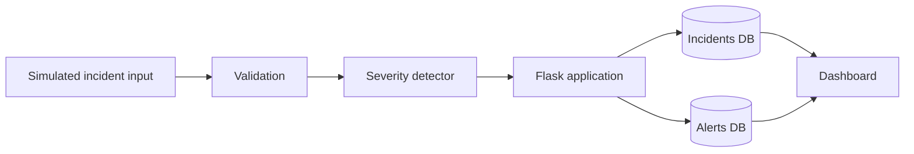

# Automated Emergency Response System

> **Portfolio reconstruction:** This repository is a modern rebuild based on the academic project description represented in my portfolio/CV. It is not presented as the exact archived source code from the original submission.

A complete educational safety-tech prototype that simulates accident detection, severity classification, incident persistence, alert auditing and operator response.


## What this repository demonstrates

This is structured as a complete software project rather than a README-only portfolio entry. It includes:

- working Flask application code
- separate severity-classification module
- SQLite schema with constraints, foreign keys and indexes
- deterministic seed data
- sample analytical SQL queries
- server-rendered dashboard
- JSON incident API and health endpoint
- automated unit/integration-style tests
- GitHub Actions CI
- GitHub Pages static demo workflow
- architecture, sequence, decision-flow and ER diagrams
- database documentation
- API documentation
- testing documentation
- deployment/runbook documentation
- security and safety notes
- formal technical project report

## Core workflow



## Technology

Python · Flask · SQLite · HTML · CSS · Jinja · SQL · GitHub Actions · Mermaid

## Repository structure

```text
.
├── app.py                     # Flask application, validation, API, health check
├── detector.py                # Severity rules and alert message builder
├── schema.sql                 # Database schema, constraints and indexes
├── seed.sql                   # Demonstration data
├── requirements.txt           # Python dependency lock
├── Makefile                   # Common developer commands
├── database/
│   ├── README.md              # Database package guide
│   └── sample_queries.sql     # Reporting/inspection SQL examples
├── templates/
│   └── index.html             # Flask dashboard
├── static/
│   └── style.css              # Interface styling
├── tests/
│   └── test_app.py            # Automated tests
├── docs/
│   ├── index.html             # Static GitHub Pages demo
│   ├── ARCHITECTURE.md        # Architecture + Mermaid diagrams
│   ├── DATABASE.md            # ER model + data dictionary
│   ├── API.md                 # HTTP interface documentation
│   ├── TESTING.md             # QA strategy and test cases
│   ├── DEPLOYMENT.md          # Setup, CI and deployment runbook
│   ├── SECURITY.md            # Security/safety review
│   ├── REPORT.md              # Full technical project report
│   └── assets/                # Documentation imagery
└── .github/workflows/
    ├── ci-pages.yml           # Compile + test CI
    └── pages-enable.yml       # Static docs deployment
```

## Severity model

| Condition | Classification |
|---|---|
| Impact < 2g | LOW |
| 2g ≤ impact < 4g | MEDIUM |
| Impact ≥ 4g | HIGH |
| Impact ≥ 6g and no motion after impact | CRITICAL |

These thresholds are illustrative portfolio logic only and are not medically or automotive validated.

## Run locally

```bash
python -m venv .venv
source .venv/bin/activate  # Windows: .venv\Scripts\activate
pip install -r requirements.txt
flask --app app run
```

Open `http://127.0.0.1:5000`.

The SQLite database is created and seeded automatically on first use.

Useful commands:

```bash
make test
make init-db
make run
```

## API checks

```text
GET /health
GET /api/incidents
```

## Testing

```bash
python -m unittest discover -s tests -v
```

CI also compiles the Python files and runs the same test suite on pushes and pull requests to `main`.

## Documentation

Start with:

- [Architecture](docs/ARCHITECTURE.md)
- [Database design](docs/DATABASE.md)
- [API](docs/API.md)
- [Testing](docs/TESTING.md)
- [Deployment](docs/DEPLOYMENT.md)
- [Security & safety](docs/SECURITY.md)
- [Technical report](docs/REPORT.md)

## Static demo

The standalone site in `docs/index.html` can be published with GitHub Pages. The deployment workflow is configured to upload the `docs` directory.

Expected URL:

`https://rsswethaa.github.io/automated-emergency-response-system/`

## Safety note

This is an educational software prototype only. It is not a certified emergency, medical, automotive or public-safety system and must not be relied on for real emergency response.

## Author

Swethaa Sri Ravi Sankar — B.Tech Computer Science and Business Systems; Master of Applied Finance candidate, University of Auckland.
