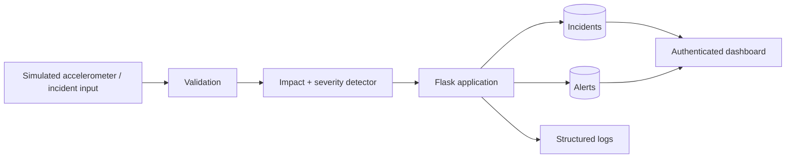

# Automated Emergency Response System

[](https://github.com/rsswethaa/automated-emergency-response-system/actions/workflows/ci-pages.yml)


**Status: portfolio prototype / academic reconstruction**

A Flask-based safety-tech prototype that simulates accelerometer impact detection, severity classification, incident persistence, alert creation and operator response. It is designed to demonstrate validation, secure state-changing actions, database transactions, API design, testing and deployment practices—not to operate as a real emergency system.


> **Portfolio reconstruction:** this is a modern rebuild based on the academic project description represented in my CV/portfolio. It is not presented as an archived copy of the original submission.

## What the system actually does

- accepts browser or JSON incident input
- validates finite latitude, longitude and impact values with explicit bounds
- rejects NaN, infinity and invalid motion values
- simulates accelerometer streams and detects shock spikes against a median baseline
- classifies validated impacts as LOW, MEDIUM, HIGH or CRITICAL
- stores incidents and simulated alerts in SQLite inside one transaction
- protects browser mutations with CSRF tokens
- supports authenticated responder/admin sessions
- protects JSON incident creation with an API key or admin session
- records structured lifecycle logs for incident creation, alert creation and resolution
- exposes health, incident and detection APIs

## Engineering practices

- Flask app factory with environment-driven configuration
- parameterised SQL and foreign-key enforcement
- pytest fixtures with an isolated temporary SQLite database per test
- branch coverage gate of **70% or higher**
- Ruff linting and MyPy checking in CI
- pre-commit hooks for linting, formatting and type checking
- Docker image running Gunicorn as a non-root user
- Docker Compose local workflow with persistent database storage
- `.env.example` for configuration without committed secrets
- GitHub Actions checks on pushes and pull requests

## Architecture



## Severity model

| Condition | Classification |
|---|---|
| Impact < 2g | LOW |
| 2g ≤ impact < 4g | MEDIUM |
| Impact ≥ 4g | HIGH |
| Impact ≥ 6g and no motion after impact | CRITICAL |

These thresholds are illustrative portfolio rules only. They are not medically, automotive or emergency-response validated.

## Run locally

```bash
python -m venv .venv
source .venv/bin/activate  # Windows: .venv\Scripts\activate
pip install -r requirements-dev.txt
flask --app app run
```

Open `http://127.0.0.1:5000`.

The demo database is created automatically on first use. Copy `.env.example` to `.env` and replace the placeholder secrets before using non-default credentials.

## Run with Docker

```bash
docker compose up --build
```

Open `http://127.0.0.1:8000`.

The container uses Gunicorn with debug mode disabled and persists SQLite data in a named Docker volume.

## Quality checks

```bash
make test
make coverage
make lint
make type
make quality
```

Or run the individual tools directly:

```bash
pytest --cov=app --cov=detector --cov-report=term-missing --cov-fail-under=70
ruff check app.py detector.py tests
mypy detector.py
pre-commit run --all-files
```

CI also compiles the Python files and builds the Docker image so packaging errors are caught before merge.

## API

- `GET /health` — database/service health
- `GET /api/incidents` — authenticated incident list
- `POST /api/incidents` — create a validated incident with API-key/admin authentication
- `POST /api/detect` — analyse accelerometer samples and return impact detection/severity

Full request/response details are in [docs/API.md](docs/API.md).

## Static project demo

The `docs/` directory contains a static presentation version that can be served with GitHub Pages. It is only a visual demonstration; the authenticated Flask application and APIs require a Python server or container.

## Known limitations / roadmap

Current limitations:

- severity thresholds and detector parameters are illustrative rather than validated against real crash data
- SQLite is appropriate for a small single-service prototype, not high-concurrency emergency infrastructure
- API-key authentication is intentionally simple and does not include token rotation or rate limiting
- no external dispatch, SMS, GPS hardware or emergency-service integration is performed
- the accelerometer detector uses an explainable threshold approach rather than a trained anomaly model

Possible next steps:

- evaluate the detector on a labelled simulated or public sensor dataset and report precision/recall
- compare threshold detection with an anomaly model such as Isolation Forest
- migrate one service version to SQLAlchemy/Alembic to demonstrate schema migrations
- add rate limiting and stronger API credential management
- deploy the dynamic Flask application to a managed service and link the live URL here

## Documentation

- [Architecture](docs/ARCHITECTURE.md)
- [API](docs/API.md)
- database schema: `schema.sql`
- example reporting queries: `database/sample_queries.sql`

The repository intentionally keeps the README as the main entry point rather than requiring a reviewer to read every supporting document.

## What I learned

This project reinforced the importance of validating numeric edge cases such as NaN/infinity, separating detection logic from the web layer, using transactions for related database writes, protecting state-changing routes, testing with isolated databases, and treating CI/container configuration as part of the product rather than as an afterthought.

## Safety boundary

This is educational software only. It is not a certified emergency, medical, automotive or public-safety system and must not be relied on for real emergency response.

## License

MIT — see [LICENSE](LICENSE).

## Author

Swethaa Sri Ravi Sankar — B.Tech Computer Science and Business Systems; Master of Applied Finance candidate, University of Auckland.
