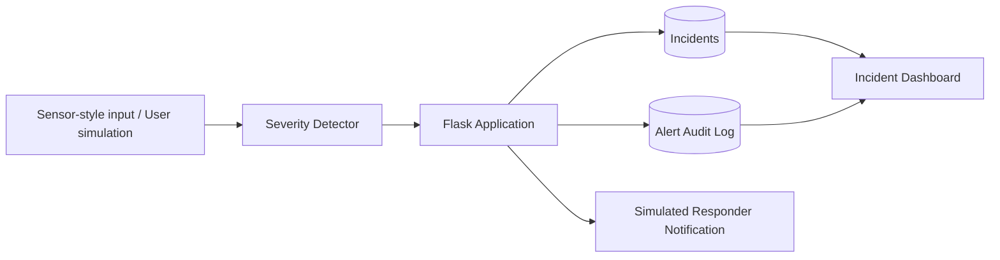
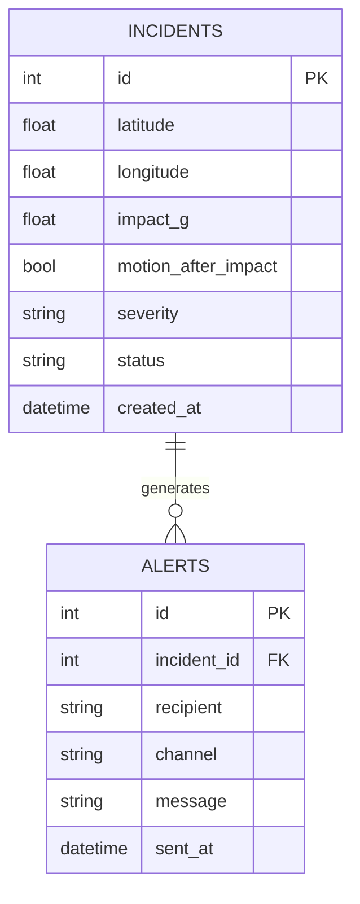

# Architecture

## Severity logic
- **LOW:** impact below 2g
- **MEDIUM:** impact from 2g to below 4g
- **HIGH:** impact from 4g upward unless critical rule applies
- **CRITICAL:** impact at or above 6g combined with no detected movement after impact

The thresholds are illustrative portfolio logic only, not medically or automotive validated thresholds.

## Data model

## Workflow
1. A simulated incident supplies location, impact and movement state.
2. `detector.py` assigns a severity category.
3. The incident is stored in SQLite.
4. A simulated notification is recorded in the alert audit table.
5. The dashboard displays incident state and allows resolution.
