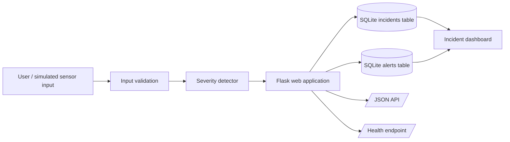
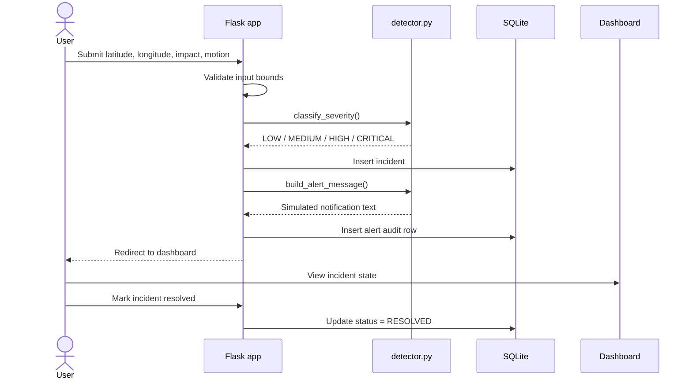
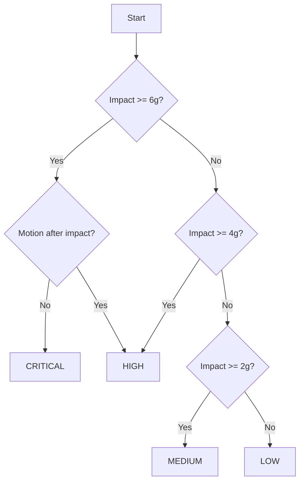
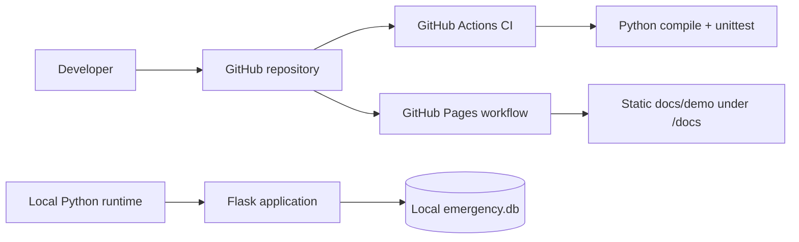

# System Architecture

This document explains how the portfolio prototype is structured, how data moves through it and where its safety boundaries sit.

## 1. High-level architecture

The design deliberately separates severity classification from the web layer. `detector.py` contains the classification rule engine, while `app.py` coordinates HTTP requests, persistence and presentation.

## 2. Component responsibilities

| Component | Responsibility |
|---|---|
| `app.py` | Flask routes, validation, database lifecycle, persistence, API and dashboard orchestration |
| `detector.py` | Severity classification and simulated alert-message construction |
| `schema.sql` | Relational schema, constraints, foreign keys and indexes |
| `seed.sql` | Deterministic demonstration records |
| `templates/index.html` | Server-rendered operator/dashboard UI |
| `static/style.css` | Presentation styling |
| `tests/test_app.py` | Automated route, validation, API and rule tests |
| `docs/` | Architecture, database, testing, deployment and report documentation |

## 3. Incident processing sequence

## 4. Severity decision flow

These thresholds are intentionally illustrative and are not validated medical, automotive or emergency-response thresholds.

## 5. Deployment architecture

The Flask app is intended for local/demo execution. The static `docs/index.html` site is separate and can be published through GitHub Pages.

## 6. Design choices

- SQLite keeps setup friction low and makes the project easy to review.
- Parameterised SQL is used for application writes.
- Database constraints enforce valid coordinates, non-negative impact values, known severity values and known incident states.
- Foreign-key cascading keeps alert rows tied to their incident lifecycle.
- Separate JSON and health endpoints make the system easier to test and integrate.

## 7. Safety boundary

This is an educational software prototype. It does not perform certified crash detection, call emergency services, diagnose injuries or guarantee responder notification.
