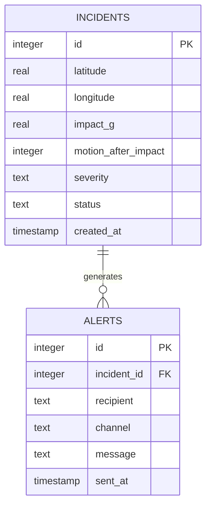

# Database Design

## 1. Technology

The project uses SQLite. This is appropriate for a self-contained academic/portfolio prototype because reviewers can clone the repository and run it without provisioning a separate database service.

## 2. Entity relationship model

## 3. Data dictionary

### `incidents`

| Field | Type | Rule | Purpose |
|---|---|---|---|
| `id` | INTEGER | Primary key, auto-increment | Incident identifier |
| `latitude` | REAL | -90 to 90 | Simulated incident latitude |
| `longitude` | REAL | -180 to 180 | Simulated incident longitude |
| `impact_g` | REAL | >= 0 | Simulated impact magnitude |
| `motion_after_impact` | INTEGER | 0 or 1 | Whether motion was detected |
| `severity` | TEXT | LOW/MEDIUM/HIGH/CRITICAL | Rule-engine outcome |
| `status` | TEXT | OPEN/RESOLVED | Workflow state |
| `created_at` | TIMESTAMP | Default current timestamp | Creation audit value |

### `alerts`

| Field | Type | Rule | Purpose |
|---|---|---|---|
| `id` | INTEGER | Primary key, auto-increment | Alert identifier |
| `incident_id` | INTEGER | Foreign key | Links alert to incident |
| `recipient` | TEXT | Required | Simulated target |
| `channel` | TEXT | Required | Delivery method label |
| `message` | TEXT | Required | Simulated alert payload |
| `sent_at` | TIMESTAMP | Default current timestamp | Alert audit timestamp |

## 4. Integrity controls

The schema adds CHECK constraints for coordinate ranges, impact values, severity categories, workflow status and Boolean-style motion values. Alerts use `ON DELETE CASCADE` so orphan alert records cannot remain if an incident is removed.

Indexes are created on incident creation time, status, severity and alert foreign keys to make common dashboard/reporting queries efficient as the demonstration dataset grows.

## 5. Database lifecycle

On first application use, `app.py` checks whether the `incidents` table exists. If it does not, it executes `schema.sql` followed by `seed.sql` and commits the result. `flask --app app init-db` can be used to deliberately reset the demonstration database.

The generated `emergency.db` file is runtime state and is excluded from version control.

## 6. Example analytical queries

See `database/sample_queries.sql` for examples covering recent incidents, open incidents by severity, alert audit trails and average impact by severity.

## 7. Production evolution

For a real multi-user system, SQLite should be replaced with a managed relational database such as PostgreSQL, with migrations, encryption, access control, backups and retention policies. That production architecture is intentionally outside the scope of this prototype.
